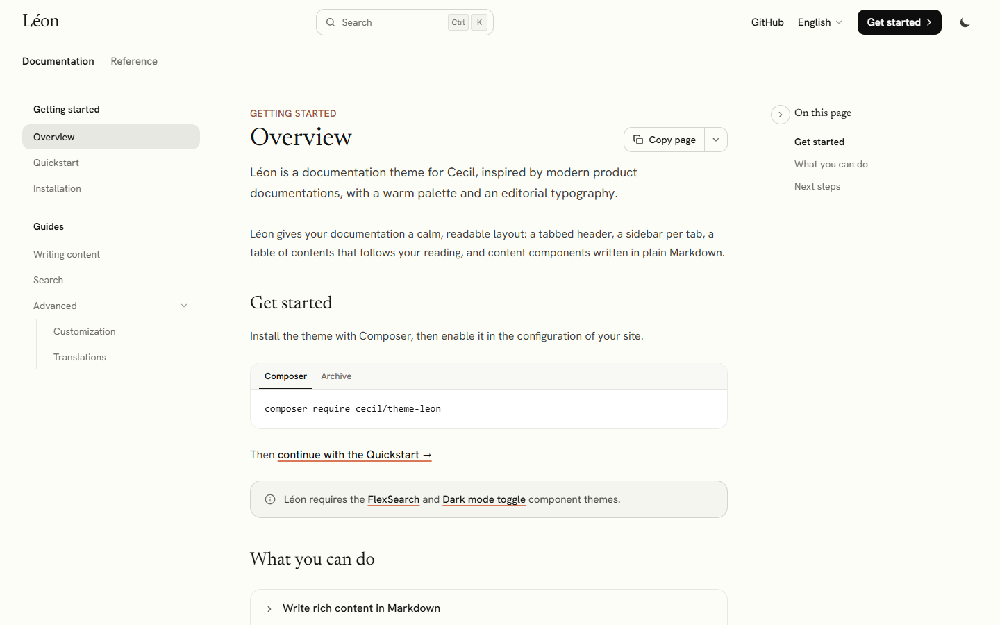

# Léon theme

_Léon_ is a documentation theme for [Cecil](https://cecil.app), with a warm palette, an editorial typography and everything a technical documentation needs: tabs, sidebar, table of contents, search, content components and AI friendly pages.

**[Demo](https://cecilapp.github.io/theme-leon/)**



## Features

- Header with **tabs**: each top level section is a tab, with its own **sidebar** built from nested sections (groups and collapsible sub-sections)
- "On this page" **table of contents**, following the reading, and collapsible
- **Search** with [FlexSearch](https://github.com/Cecilapp/theme-flexsearch) (<kbd>Ctrl</kbd>/<kbd>⌘</kbd> + <kbd>K</kbd>)
- **Light and dark** color schemes with [Dark mode toggle](https://github.com/Cecilapp/theme-darkmodetoggle)
- Content components written in **plain Markdown**: callouts, tabs, code groups, steps, accordions and cards
- Code blocks with syntax highlighting and copy button, Mermaid diagrams
- **"Copy page"** menu: copy the page as Markdown, view it as Markdown, open it in Claude or ChatGPT
- "Edit this page" link, "Last updated" date, previous/next pages
- Footer with a column of links per tab, the `footer` menu, social links and the language selector
- Home page with a hero and cards
- Configurable accent color and fonts, design tokens as CSS custom properties
- Bundled fonts ([Hanken Grotesk](https://github.com/marcologous/hanken-grotesk) and [Newsreader](https://github.com/productiontype/Newsreader), SIL Open Font License)
- SEO and social tags with the Cecil built-in `metatags` partial
- Optional [PWA](https://github.com/Cecilapp/theme-pwa) support
- Translated in English and French, with an optional suggestion of the page translation matching the browser language

## Installation

Requires Cecil 9.12.0 or later.

```bash
composer require cecil/theme-leon
```

> Or [download the latest archive](https://github.com/Cecilapp/theme-leon/releases/latest/) and uncompress its content in `themes/leon`, then do the same for [`flexsearch`](https://github.com/Cecilapp/theme-flexsearch) and [`darkmodetoggle`](https://github.com/Cecilapp/theme-darkmodetoggle).

## Usage

Add `leon` and its components in the `theme` section of your configuration:

```yaml
theme:
  - leon
  - flexsearch
  - darkmodetoggle
```

> [!IMPORTANT]
> Theme dependencies are not loaded automatically: `flexsearch` and `darkmodetoggle` must be declared too.

### Content structure

Each top level section of `pages/` becomes a tab, and its sub-sections become the groups of the sidebar:

```plaintext
pages/
├─ index.md                  # home page (hero + cards)
├─ docs/                     # "Docs" tab
│  ├─ index.md
│  ├─ getting-started/       # "Getting started" group
│  │  ├─ index.md
│  │  ├─ 1-overview.md
│  │  └─ 2-quickstart.md
│  └─ guides/                # "Guides" group
│     ├─ index.md
│     ├─ 1-writing.md
│     └─ advanced/           # collapsible sub-section
│        ├─ index.md
│        └─ 1-customization.md
└─ reference/                # "Reference" tab
   └─ …
```

Pages are ordered by `weight` (the `1-` prefix of the file name, or the `weight` front matter variable), so configure Cecil accordingly, and disable the pagination of sections:

```yaml
pages:
  sortby: weight
  pagination:
    enabled: false
```

### Markdown version and `llms.txt`

Enable the `markdown` and `llms` output formats to provide a Markdown version of each page (used by the "Copy page" menu) and an `llms.txt` file:

```yaml
output:
  pagetypeformats:
    page: [html, markdown]
    section: [html, markdown]
    homepage: [html, llms]
```

Without them, "Copy page" copies the text of the page, and "View as Markdown" is hidden.

### Content components

Components use the `:::` blocks syntax of Cecil. In tabs, code groups, steps and accordions, each `####` heading starts a new item.

````markdown
:::tip
Callouts: `note`, `info`, `tip`, `warning`, `danger` (or `caution`), `important` and `check`.
:::

:::tabs
#### macOS
```bash
brew install cecil
```
#### Windows
```powershell
scoop install cecil
```
:::

:::code-group
```yaml
theme: [leon]
```
```json
{"theme": ["leon"]}
```
:::

:::steps
#### Install
Run the installer.
#### Configure
Edit `cecil.yml`.
:::

:::accordion
#### What is Cecil?
A static site generator.
:::

:::cards
- [Quickstart](quickstart.md): first steps
- [Configuration](configuration.md): every option
:::
````

Tabs with the same label are synchronized across the page, and the choice of the reader is remembered. A code group without headings names its tabs after the language of each code block. Blocks can't be nested: a line made of `:::` closes the block.

Components are rendered in HTML when the site is built, by the `partials/notes/<type>.html.twig` templates (overridable in the site `layouts/`): JavaScript only makes tabs interactive, and without it their panels are stacked under their title.

### Front matter

| Variable        | Description                                                         |
|-----------------|---------------------------------------------------------------------|
| `description`   | Displayed under the title                                           |
| `eyebrow`       | Text above the title (name of the group by default)                 |
| `sidebar_title` | Title in the sidebar                                                |
| `collapsed`     | Collapses a nested section in the sidebar                           |
| `toc`           | `false` to hide the table of contents                               |
| `copypage`      | `false` to hide the "Copy page" button                              |
| `cards`         | `false` to hide the cards of a section page                         |
| `updated`       | "Last updated" date                                                 |
| `hero`          | Home page: `title`, `description` and `search` (`false` to hide it) |
| `cards`         | Home page: list of `title`, `description` and `url`                 |

### Configuration

Default values:

```yaml
leon:
  accent: ''         # accent color (e.g. '#2563eb'), clay ('#D97757') by default
  accent_dark: ''    # accent color in dark mode, derived from `accent` by default
  fonts:
    bundled: true    # loads the bundled fonts (Hanken Grotesk and Newsreader), false to use your own
    sans: ''         # body font family (e.g. 'Inter, sans-serif')
    serif: ''        # headings font family (e.g. 'Georgia, serif')
    mono: ''         # code font family
  header:
    title: true      # displays the site title next to the logo (header and footer)
    cta: {}          # call to action button (e.g. {name: Get started, url: /docs/})
  tabs:
    enabled: true    # top level sections as tabs, each one with its own sidebar
    sections: []     # ids of the sections to display as tabs (all top level sections by default)
  sidebar:
    collapsed: false # collapses the nested groups, except the one of the current page
  language:
    suggest: false   # suggests the translation of the page matching the browser language
  toc:
    enabled: true    # "On this page" table of contents
  copypage:
    enabled: true    # "Copy page" button and menu
    assistants:      # "Open in…" entries: claude, chatgpt and/or perplexity
      - claude
      - chatgpt
  github:
    repo: ''         # e.g. https://github.com/<user>/<repo>, enables "Edit this page"
    branch: main
    path: pages
  lastupdated: false # displays the page date as "Last updated"
  social: {}         # social links in the footer, e.g. {github: https://github.com/<user>, bluesky: https://bsky.app/profile/<user>}
  footer: ''         # footer text (supports Markdown, `%author%` and `%year%`)
  mermaid:
    version: '11.17.2'
```

#### Logo

The logo is set by the `logo` key at the root of the site configuration (not under `leon`), with a path relative to the `assets/` or `static/` directory. It is displayed 28 pixels high, followed by the site title, in the header and in the footer:

```yaml
logo: images/logo.svg
```

To use a different file in each color scheme, set `light` and `dark` files:

```yaml
logo:
  light: images/logo.svg      # dark logo, displayed on the light background
  dark: images/logo-dark.svg  # light logo, displayed on the dark background
```

If the logo already contains the name of the site, hide the title with `leon.header.title: false`.

#### Menus and footer

Links of the `main` menu are displayed in the header (sections displayed as tabs excepted). Under the logo, the footer displays the `baseline` of the site and the `leon.footer` text, then lists the pages of each tab (its sub-sections and pages), then the links of the `footer` menu under "Resources", and the `social` links as icons: `github`, `gitlab`, `bluesky`, `mastodon`, `x`, `youtube`, `discord`, `opencollective` and `rss` (a globe for any other name).

### Customization

Colors, fonts and other design tokens are CSS custom properties (`--leon-*`), defined in [`assets/css/tailwind.css`](assets/css/tailwind.css) for the light (`:root`) and the dark (`.dark`) color schemes: override them in your own styles. Every template can be overridden by a file with the same path in the `layouts/` directory of the site.

The stylesheet is built with [Tailwind CSS](https://tailwindcss.com):

```bash
composer install
composer css:build # or css:watch
```

### Internationalization

The theme is translated in English and French: add a `translations/messages.<locale>.yml` file to your site to translate it in another language.

With `leon.language.suggest: true`, a banner suggests the translation of the page matching the browser language (written in that language). It stays displayed from page to page until the visitor follows it, closes it or chooses a language with the selector. Set it in the `leon` block of each language (see below).

On a multilingual site, translate the options in the `config` key of each language. Cecil doesn't merge them with the default language: menus are not inherited at all, and a `leon` key replaces the whole `leon` block, so repeat it in full (`github` included, or the "Edit this page" link disappears):

```yaml
languages:
  - code: en
    name: English
    locale: en_US
  - code: fr
    name: Français
    locale: fr_FR
    config:
      menus:
        main:
          - id: github
            name: GitHub
            url: https://github.com/<owner>/<repo>
      leon:
        header:
          cta:
            name: Commencer
            url: /docs/
        github:
          repo: https://github.com/<owner>/<repo>
        footer: 'Publié sous licence MIT.'
```

## Demo

```bash
php demo/link.php
php cecil.phar serve demo
```

## Credits

Léon is inspired by the design of modern product documentations, such as [Claude Code Docs](https://code.claude.com/docs/). It is not affiliated with Anthropic, and doesn't use any of its assets.

## License

_Léon_ is a free software distributed under the terms of the MIT license.

Bundled fonts are distributed under the terms of the [SIL Open Font License](static/fonts/).
