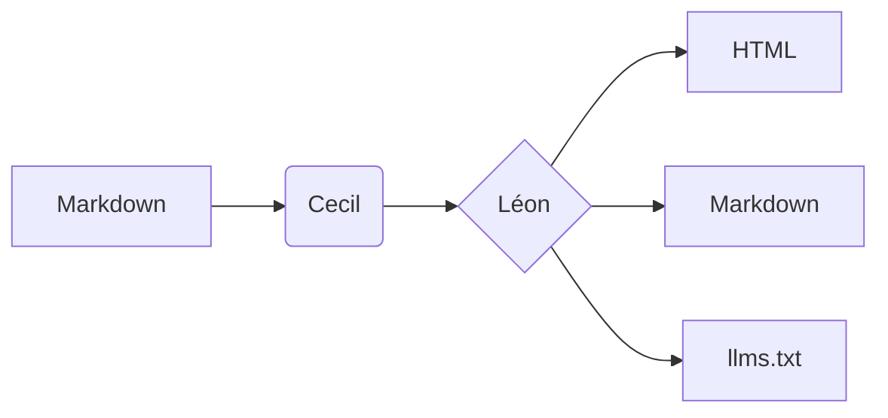

## Encadrés

Les encadrés mettent une information en valeur. Utilisez `:::note`, `:::info`, `:::tip`, `:::warning`, `:::danger` ou `:::important` :

:::note
Une **note** apporte du contexte, et peut contenir n'importe quel Markdown : `code`, [liens](#encadres), listes…
:::

:::info
Les installations natives se mettent à jour automatiquement en arrière-plan.
:::

:::tip
Organisez votre contenu en dossiers imbriqués pour construire la barre latérale.
:::

:::warning
La clé `theme` de la configuration d'un thème est ignorée : déclarez tous les thèmes dans votre site.
:::

:::danger
Ne commitez jamais vos clés d'API.
:::

:::important
Les encadrés `important` utilisent la couleur d'accent du thème.
:::

```markdown
:::tip
Organisez votre contenu en dossiers imbriqués pour construire la barre latérale.
:::
```

## Onglets

Chaque titre `####` démarre un nouvel onglet. Les onglets de même libellé sont synchronisés sur toute la page, et le choix est mémorisé.

:::tabs
#### macOS
Installez avec Homebrew :

```bash
brew install cecil
```

#### Windows
Installez avec Scoop :

```powershell
scoop install cecil
```

#### Linux
Téléchargez le Phar :

```bash
curl -LO https://cecil.app/cecil.phar
```
:::

## Groupes de code

Un groupe de code présente des blocs de code alternatifs dans un même cadre :

:::code-group
#### macOS
```bash
brew install cecil
```
#### Windows
```powershell
scoop install cecil
```
#### Linux
```bash
curl -LO https://cecil.app/cecil.phar
```
:::

Sans titres, les onglets prennent le nom du langage de chaque bloc :

:::code-group
```yaml
theme:
  - leon
```
```json
{"theme": ["leon"]}
```
:::

## Étapes

:::steps
#### Écrire
Rédigez vos pages en Markdown.

#### Générer
Lancez `php cecil.phar build`.

#### Publier
Déployez le dossier `_site` où vous voulez.
:::

## Accordéons

:::accordion
#### Qu'est-ce que Cecil ?
Un générateur de site statique, écrit en PHP, qui transforme des fichiers Markdown en site web.

#### Puis-je utiliser du HTML ?
Oui, et un élément natif `<details>` est lui aussi mis en forme comme un accordéon.
:::

## Cartes

:::cards
- [Démarrage rapide](../../getting-started/quickstart/) : créer un site de zéro
- [Configuration](../../../reference/configuration/) : toutes les options du thème
:::

## Imbrication

Un bloc peut en contenir d'autres : sa clôture doit alors être plus longue que la leur (`::::steps` … `::::`).

::::steps
#### Installer
:::code-group
```bash
brew install cecil
```
```powershell
scoop install cecil
```
:::

#### Configurer
:::tip
Ajoutez `leon` à la liste `theme` de votre site.
:::

#### Générer
Lancez `cecil build`.
::::

::::tabs
#### Composer
```bash
composer require cecil/theme-leon
```

#### Archive
:::warning
Installez aussi les thèmes de composants requis.
:::
::::

````markdown
::::steps
#### Configurer
:::tip
Ajoutez `leon` à la liste `theme` de votre site.
:::
::::
````

## Code

Du `code` en ligne, des touches de clavier comme <kbd>Ctrl</kbd> + <kbd>K</kbd>, et des blocs avec coloration syntaxique :

```php
<?php
// génère le site
$builder = Cecil\Builder::create($config);
$builder->build(['drafts' => false]);
```

```twig

  <a href="{{ url(page) }}">{{ page.title }}</a>

```

## Tableaux

| Ce que je veux faire | Meilleure option |
| -------------------- | ---------------- |
| Rechercher dans la documentation | Appuyer sur <kbd>Ctrl</kbd> + <kbd>K</kbd> |
| Lire une page en Markdown | **Copier la page** → Voir en Markdown |
| Interroger un assistant IA | **Copier la page** → Ouvrir dans Claude |

## Diagrammes



## Citations et listes

> La simplicité est la sophistication suprême.

1. Premier élément
2. Deuxième élément
   - Élément imbriqué
   - Un autre
3. Troisième élément
