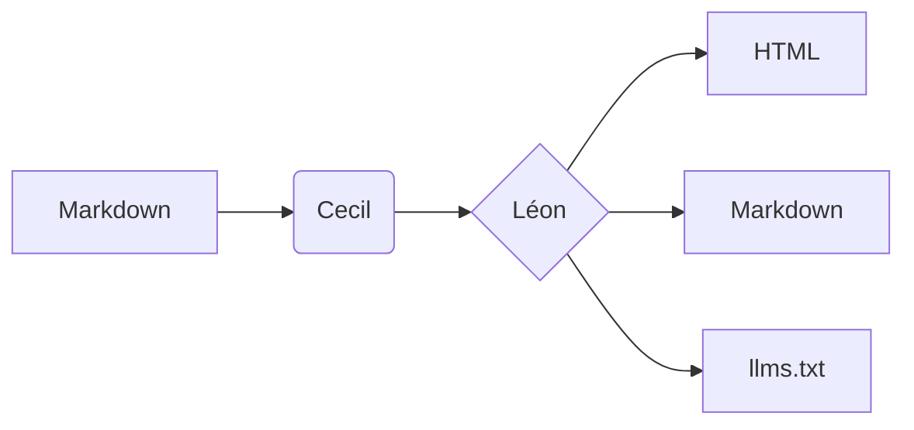

## Callouts

Callouts highlight information. Use `:::note`, `:::info`, `:::tip`, `:::warning`, `:::danger` or `:::important`:

:::note
A **note** gives extra context, and can contain any Markdown: `code`, [links](#callouts), lists…
:::

:::info
Native installations update automatically in the background.
:::

:::tip
Organize your content in nested folders to build the sidebar.
:::

:::warning
The `theme` key of a theme configuration is ignored: declare all the themes in your site.
:::

:::danger
Never commit your API keys.
:::

:::important
`important` callouts use the accent color of the theme.
:::

```markdown
:::tip
Organize your content in nested folders to build the sidebar.
:::
```

## Tabs

Each `####` heading starts a new tab. Tabs with the same label are synchronized across the page, and the choice is remembered.

:::tabs
#### macOS
Install with Homebrew:

```bash
brew install cecil
```

#### Windows
Install with Scoop:

```powershell
scoop install cecil
```

#### Linux
Download the Phar:

```bash
curl -LO https://cecil.app/cecil.phar
```
:::

````markdown
:::tabs
#### macOS
Install with Homebrew:

```bash
brew install cecil
```

#### Windows
Install with Scoop:

```powershell
scoop install cecil
```

#### Linux
Download the Phar:

```bash
curl -LO https://cecil.app/cecil.phar
```
:::
````

## Code groups

A code group shows alternative code blocks in a single frame:

:::code-group
#### macOS
```bash
brew install cecil
```
#### Windows
```powershell
scoop install cecil
```
#### Linux
```bash
curl -LO https://cecil.app/cecil.phar
```
:::

````markdown
:::code-group
#### macOS
```bash
brew install cecil
```
#### Windows
```powershell
scoop install cecil
```
#### Linux
```bash
curl -LO https://cecil.app/cecil.phar
```
:::
````

Without headings, tabs are named after the language of each block:

:::code-group
```yaml
theme:
  - leon
```
```json
{"theme": ["leon"]}
```
:::

````markdown
:::code-group
```yaml
theme:
  - leon
```
```json
{"theme": ["leon"]}
```
:::
````

## Steps

:::steps
#### Write
Write your pages in Markdown.

#### Build
Run `php cecil.phar build`.

#### Publish
Deploy the `_site` folder anywhere.
:::

````markdown
:::steps
#### Write
Write your pages in Markdown.

#### Build
Run `php cecil.phar build`.

#### Publish
Deploy the `_site` folder anywhere.
:::
````

## Accordions

:::accordion
#### What is Cecil?
A static site generator, written in PHP, that turns Markdown files into a website.

#### Can I use HTML?
Yes, and a native `<details>` element is styled as an accordion too.
:::

````markdown
:::accordion
#### What is Cecil?
A static site generator, written in PHP, that turns Markdown files into a website.

#### Can I use HTML?
Yes, and a native `<details>` element is styled as an accordion too.
:::
````

## Cards

:::cards
- [Quickstart](../../getting-started/quickstart/): create a site from scratch
- [Configuration](../../../reference/configuration/): every option of the theme
:::

````markdown
:::cards
- [Quickstart](../../getting-started/quickstart/): create a site from scratch
- [Configuration](../../../reference/configuration/): every option of the theme
:::
````

## Nesting

A block can contain other blocks: its fence must then be longer than theirs (`::::steps` … `::::`).

::::steps
#### Install
:::code-group
```bash
brew install cecil
```
```powershell
scoop install cecil
```
:::

#### Configure
:::tip
Add `leon` to the `theme` list of your site.
:::

#### Build
Run `cecil build`.
::::

````markdown
::::steps
#### Install
:::code-group
```bash
brew install cecil
```
```powershell
scoop install cecil
```
:::

#### Configure
:::tip
Add `leon` to the `theme` list of your site.
:::

#### Build
Run `cecil build`.
::::
````

::::tabs
#### Composer
```bash
composer require cecil/theme-leon
```

#### Archive
:::warning
Also install the required component themes.
:::
::::

````markdown
::::tabs
#### Composer
```bash
composer require cecil/theme-leon
```

#### Archive
:::warning
Also install the required component themes.
:::
::::
````

## Code

Inline `code`, keyboard keys like <kbd>Ctrl</kbd> + <kbd>K</kbd>, and blocks with syntax highlighting:

```php
<?php
// builds the site
$builder = Cecil\Builder::create($config);
$builder->build(['drafts' => false]);
```

```twig

  <a href="{{ url(page) }}">{{ page.title }}</a>

```

## Tables

| What I want to do | Best option |
| ----------------- | ----------- |
| Search the documentation | Press <kbd>Ctrl</kbd> + <kbd>K</kbd> |
| Read a page as Markdown | **Copy page** → View as Markdown |
| Ask an AI assistant | **Copy page** → Open in Claude |

## Diagrams



## Quotes and lists

> Simplicity is the ultimate sophistication.

1. First item
2. Second item
   - Nested item
   - Another one
3. Third item
